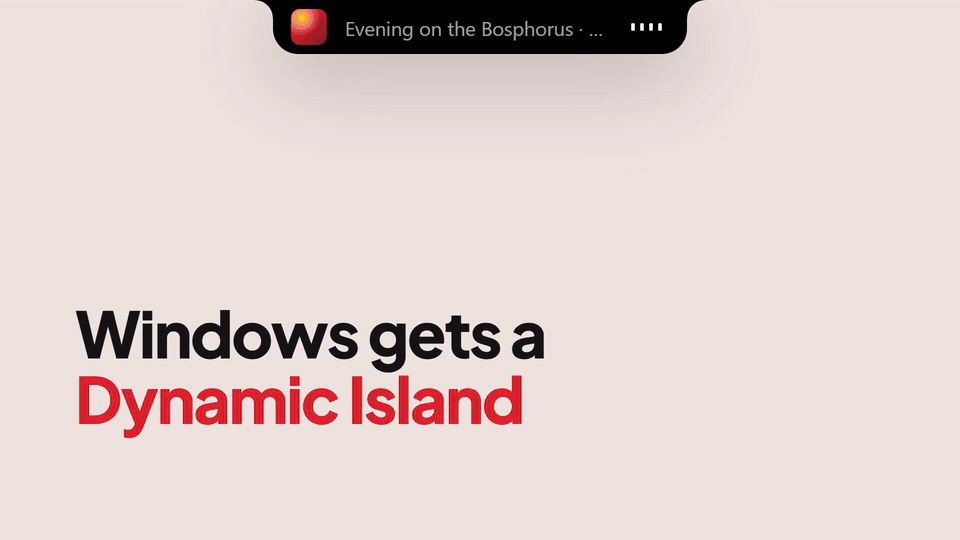
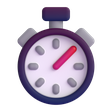

<p align="center"></p>
<h1 align="center">Ada</h1>
<p align="center"><b>A free, open-source Dynamic Island for Windows 10 &amp; 11.</b><br>
Native Rust · ~700 KB · 0 FPS when idle</p>

<p align="center">
  <a href="https://github.com/Yemresalcan/ada-notch/releases/latest"></a>
  <a href="https://github.com/Yemresalcan/ada-notch/releases"></a>
  <a href="https://github.com/Yemresalcan/ada-notch/actions"></a>
  <a href="LICENSE"></a>
  <a href="#install"></a>
  <a href="https://github.com/Yemresalcan/ada-notch/stargazers"></a>
</p>

<p align="center">
  <a href="https://github.com/Yemresalcan/ada-notch/releases/latest"><b>Download</b></a> ·
  <a href="https://yemresalcan.github.io/ada-notch/">Website</a> ·
  <a href="#features">Features</a> ·
  <a href="#build-from-source">Build from source</a> ·
  <a href="#türkçe">Türkçe</a>
</p>

<p align="center"></p>

**Ada** places a small black pill at the top-center of your screen that smoothly expands into an interactive panel when you hover over it. Built directly on Win32, Direct2D, and DirectComposition via the `windows` crate, it ships as a single ~700 KB executable with no runtime dependencies and 0 FPS CPU usage when idle. *"Ada"* means *"island"* in Turkish, reflected in its Turkish red-and-white visual identity.

## Features

<table>
  <tr>
    <td width="50%" valign="top">
      <br>
      <b>Media &amp; lyrics</b><br>
      Now playing from any app via Windows media controls, play/pause/next controls, synced lyrics from <a href="https://lrclib.net">LRCLIB</a>, plus album art and animated audio bars in the collapsed notch.
    </td>
    <td width="50%" valign="top">
      <br>
      <b>File shelf</b><br>
      Drag files or links onto the notch to hold them temporarily, drag them back out later, or click to open.
    </td>
  </tr>
  <tr>
    <td width="50%" valign="top">
      <br>
      <b>Todo</b><br>
      Quick checklist right at the top of your screen.
    </td>
    <td width="50%" valign="top">
      <br>
      <b>Calendar</b><br>
      Local calendar for viewing and managing upcoming items.
    </td>
  </tr>
  <tr>
    <td width="50%" valign="top">
      <br>
      <b>Focus timer</b><br>
      Pomodoro timer (25 / 5 / 15 min) with a live countdown in the collapsed notch.
    </td>
    <td width="50%" valign="top">
      <br>
      <b>Weather</b><br>
      Current conditions and short-term forecast using IP-based location and MET Norway data.
    </td>
  </tr>
  <tr>
    <td width="50%" valign="top">
      <br>
      <b>System monitor</b><br>
      Live CPU and RAM usage rings with a 60-second CPU sparkline.
    </td>
    <td width="50%" valign="top">
      <br>
      <b>Football</b> <sub>new · next release</sub><br>
      Follow one team (Beşiktaş by default): crests, next match and last result; during a live match the score stays in the notch and goals, kick-off and full time pop up. Data: ESPN.
    </td>
  </tr>
  <tr>
    <td width="50%" valign="top">
      <br>
      <b>Notifications</b><br>
      Mirrors Windows notifications as brief animated "peeks".
    </td>
    <td width="50%" valign="top">
      <br>
      <b>Idle mascot</b><br>
      After 15 seconds of inactivity, Ada writes <i>"Merhaba"</i> in handwriting, reveals two happy eyes, and waves a 3D hand.
    </td>
  </tr>
  <tr>
    <td width="50%" valign="top">
      <br>
      <b>Claude usage</b><br>
      5-hour and weekly rate-limit rings for Claude Code (reads a local JSON file; see <a href="#claude-usage">Claude usage</a>).
    </td>
    <td width="50%" valign="top">
      <br>
      <b>Settings</b><br>
      Turn any page on or off; minimal-notch mode shrinks the idle pill into an unobtrusive compact strip; tray menu for <i>Start with Windows</i>, mascot, minimal mode, and <i>Exit</i>.
    </td>
  </tr>
</table>

Every page can be turned on or off individually in **Settings**; disabled pages never start in the background.

### Screenshots

<p align="center"></p>

## Install

Download `Ada-Setup-x.y.z.exe` from the [Releases](https://github.com/Yemresalcan/ada-notch/releases) page and run it — no admin rights needed; installs to `%LOCALAPPDATA%\Programs\Ada`. A portable `ada.exe` is attached to every release too.

**Requirements:** Windows 10 (version 1903 or newer) or Windows 11, 64-bit (x64).

> [!NOTE]
> **Why does my browser or Windows warn about the download?**
>
> - **Open-source builds:** Ada is open source, and release files are built directly from this repository by [GitHub Actions](https://github.com/Yemresalcan/ada-notch/actions).
> - **Why it happens:** The executable is not code-signed yet and is new, so browsers (Chrome/Edge *"uncommon download"*) and Microsoft Defender SmartScreen (*"Windows protected your PC"*) warn about files they have not seen often. It is a reputation warning, not a virus detection. Code signing for the project is planned.
> - **How to proceed:** In the browser choose **Keep** / **Keep anyway**; in SmartScreen click **More info → Run anyway**.
> - **How to verify the file:** Every release includes `SHA256SUMS.txt`. Run the command below in PowerShell and compare the output with the value in that file (you can also scan the file on [VirusTotal](https://www.virustotal.com)):
>
> ```powershell
> Get-FileHash .\Ada-Setup-<version>.exe -Algorithm SHA256
> ```

## Usage

- **Expand / collapse:** Hover your cursor over the notch at the top-center of the screen to open the panel; move away to collapse it.
- **Switch pages:** Click the left/right arrows or the page dots along the bottom of the panel.
- **Tray menu:** Right-click the Ada icon in the system tray to toggle *Start with Windows*, the idle mascot, minimal mode, or to exit.
- **Toggle features:** Open the **Settings** page (always the last page) to turn individual pages on or off. Disabled pages are not started in the background.
- **Data location:** Settings, todos, and calendar entries are stored as plain text in `%APPDATA%\Ada` (caches and shelf files live in `%LOCALAPPDATA%\Ada`).

## Configuration

Settings live in `%APPDATA%\Ada\settings.txt` (plain text, one `key=value` per line):

| Key | Description |
| --- | --- |
| `disabled` | Comma-separated page IDs to turn off: `media`, `shelf`, `todo`, `calendar`, `focus`, `weather`, `football`, `system`, `claude`, `notifications` |
| `mascot` | `0` turns the idle mascot off |
| `minimal` | `1` enables minimal-notch mode |
| `football_team` | ESPN team ID (default `1895` = Beşiktaş) |
| `football_keep_open` | `0` = don't keep the notch open during a live match |
| `claude_usage_file` | Path to the Claude usage JSON file |

### Claude usage

The **Claude usage** page displays your remaining 5-hour and weekly Claude Code rate limits as progress rings.

Ada reads the usage JSON from the first configured path among:

1. The `ADA_CLAUDE_USAGE_FILE` environment variable
2. The `claude_usage_file` key in `%APPDATA%\Ada\settings.txt`
3. `%APPDATA%\Ada\claude-usage.json` (default)

Expected JSON format:

```json
{"rate_limits":{"five_hour":{"used_percentage":13,"resets_at":1793130600},"seven_day":{"used_percentage":91,"resets_at":1793134800}},"model":"Opus","ts":1793114906104}
```

For example, a Claude Code status-line script can write this file directly from its `rate_limits` input on each update. If you don't use Claude Code, you can turn the page off in **Settings**.

## Privacy

Everything stays local in `%APPDATA%\Ada` (and `%LOCALAPPDATA%\Ada` for caches and shelf items), with no telemetry. Network requests happen only for enabled features:

- **Weather** — MET Norway forecast data, location by IP
- **Media & lyrics** — Synced lyrics from [LRCLIB](https://lrclib.net)
- **Football** — Match schedules, live scores, and crests from ESPN

## Build from source

1. Install [Rust](https://rustup.rs/) via `rustup` (both the `msvc` and `gnu` toolchains work).
2. Run in development mode:
   ```powershell
   cargo run
   ```
3. Build an optimized release binary:
   ```powershell
   cargo build --release
   ```
4. Build the release executable with the embedded application icon (requires Python for `tools/set_icon.py`; writes `dist/ada.exe`):
   ```powershell
   powershell -ExecutionPolicy Bypass -File tools/build-release.ps1
   ```
5. Build the installer (requires [Inno Setup 6](https://jrsoftware.org/isinfo.php) or newer):
   ```powershell
   iscc installer/ada.iss
   ```

### Project layout

| Path | Description |
| --- | --- |
| `src/shell.rs` | Window management, spring animations, hit-testing, and tray menu |
| `src/gfx.rs` | Direct3D 11 / Direct2D / DirectComposition renderer and `DrawCtx` drawing API |
| `src/pages/*` | Individual feature pages (one file per page) |
| `src/mascot.rs` | Idle *"Merhaba"* handwriting animation, eyes, and 3D waving hand |
| `src/worker.rs` | Background worker threads, UI thread `Waker`, and peek queue |
| `src/http.rs` | Blocking HTTP GET over WinRT HttpClient (strings and bytes) |
| `src/store.rs` | Plain-text settings and data persistence |
| `src/theme.rs` | Layout geometry, spring constants, and color palette |
| `assets/` | Application icons and mascot artwork |
| `tools/` | Release packaging (`build-release.ps1`) and icon embedding (`set_icon.py`) |
| `installer/` | Inno Setup 6+ installer script (`ada.iss`) |

## Contributing

Contributions, bug reports, and ideas are welcome! Please read [CONTRIBUTING.md](CONTRIBUTING.md) before opening a pull request.

## License

- **License:** Apache-2.0 — see [LICENSE](LICENSE).
- **Credits & third-party notices:** see [NOTICE](NOTICE).

If Ada is useful to you, a ⭐ on GitHub helps others find it.

## Türkçe

<details><summary><b>Türkçe README'yi göster</b></summary>

Windows 10 ve 11 için Rust ile yazılmış, hafif ve yerel "Dynamic Island" tarzı ekran çentiği (notch).

**Ada**, ekranın üst-orta kısmında duran ve fareyle üzerine gelindiğinde etkileşimli bir panele dönüşen küçük siyah bir kapsüldür. `windows` küfesi (crate) üzerinden doğrudan Win32, Direct2D ve DirectComposition ile geliştirilmiştir; çalışma zamanı bağımlılığı olmayan tek bir ~700 KB `.exe` dosyasıdır ve boşta 0 FPS ile neredeyse sıfır işlemci kullanır. Türkçedeki *"ada"* kelimesinden adını alır ve kırmızı-beyaz Türk kimliğini taşır.

### Özellikler

Her sayfa **Settings** (Ayarlar) sayfasından ayrı ayrı açılıp kapatılabilir; devre dışı bırakılan sayfalar arka planda başlatılmaz:

- **Medya ve şarkı sözleri (Media & lyrics)** — Windows medya kontrolleri üzerinden çalan herhangi bir uygulamayı gösterir; oynat/duraklat/sonraki tuşları, [LRCLIB](https://lrclib.net) üzerinden senkronize şarkı sözleri ve kapalı çentikte albüm kapağı ile hareketli ses çubukları sunar.
- **Dosya rafı (File shelf)** — Dosya veya bağlantıları çentiğe sürükleyip bırakın, daha sonra dışarı sürükleyin ya da tıklayarak açın.
- **Yapılacaklar (Todo)** — Ekranın tepesinde hızlı görev listesi.
- **Takvim (Calendar)** — Yerel takvim görünümü ve etkinlik takibi.
- **Odaklanma sayacı (Focus timer)** — Kapalı çentikte geri sayım gösteren Pomodoro sayacı (25 / 5 / 15 dk).
- **Hava durumu (Weather)** — IP tabanlı konum ve MET Norway verileriyle anlık hava durumu ve saatlik tahmin.
- **Sistem izleyici (System monitor)** — Canlı CPU ve RAM kullanım halkaları ile 60 saniyelik CPU grafiği (sparkline).
- **Futbol (Football)** — Tek bir takımı takip edin (varsayılan Beşiktaş): takım armaları, sıradaki maç ve son sonuç; canlı maç sırasında skor çentikte kalır ve gol, başlama vuruşu ile maç sonu bildirim olarak açılır. Veri: ESPN.
- **Claude kullanımı (Claude usage)** — Claude Code için 5 saatlik ve haftalık kullanım limitlerini halkalar halinde gösterir (yerel bir JSON dosyasını okur; bkz. [Claude Kullanımı](#claude-kullanımı)).
- **Bildirimler (Notifications)** — Windows bildirimlerini kısa animasyonlu "peek" önizlemeleri olarak yansıtır.
- **Ayarlar (Settings)** — Sayfaları ve çentik davranışını istediğiniz zaman açıp kapatın.

Ek olarak:

- **Boşta maskotu** — 15 saniye hareketsizlikten sonra el yazısıyla *"Merhaba"* yazar, iki mutlu göz belirir ve 3B bir el sallar.
- **Minimal çentik modu** — Boştayken çentiği daha küçük ve sade bir kapsüle dönüştürür.
- **Sistem tepsisi menüsü** — *Windows ile başlat (Start with Windows)*, maskot, minimal mod ve *Çıkış (Exit)* seçeneklerine hızlı erişim sağlar.

### İndirme ve Kurulum

[Releases](https://github.com/Yemresalcan/ada-notch/releases) sayfasından `Ada-Setup-x.y.z.exe` dosyasını indirip çalıştırın (yönetici izni gerekmez; `%LOCALAPPDATA%\Programs\Ada` dizinine kurulur). Kurulumsuz kullanmak isteyenler için taşınabilir `ada.exe` dosyası da sürümlere eklenmiştir.

#### Gereksinimler

- Windows 10 (sürüm 1903 veya üzeri) ya da Windows 11
- 64-bit (x64)

### İndirirken tarayıcı veya Windows neden uyarı veriyor?

- **Açık kaynak derlemeler:** Ada açık kaynaklıdır ve sürüm dosyaları doğrudan bu depodan [GitHub Actions](https://github.com/Yemresalcan/ada-notch/actions) tarafından derlenir.
- **Uyarının nedeni:** Çalıştırılabilir dosya henüz kod imzalı değildir ve yenidir; bu nedenle tarayıcılar (Chrome/Edge "yaygın olarak indirilmiyor" / "uncommon download") ve Microsoft Defender SmartScreen ("Windows kişisel bilgisayarınızı korudu" / "Windows protected your PC") sık görülmemiş dosyalar için uyarı gösterir. Bu bir virüs tespiti değil, itibar (reputation) uyarısıdır. Proje için kod imzalama planlanmaktadır.
- **Nasıl devam edilir:** Tarayıcıda **Sakla** / **Yine de sakla** (*Keep* / *Keep anyway*) seçeneğini seçin; SmartScreen ekranında **Ek bilgi → Yine de çalıştır** (*More info → Run anyway*) düğmesine tıklayın.
- **Dosyayı doğrulama:** Her sürümde `SHA256SUMS.txt` dosyası bulunur; PowerShell'de `Get-FileHash .\Ada-Setup-<version>.exe -Algorithm SHA256` komutunu çalıştırıp sonucu bu dosyadaki değerle karşılaştırın.
- **İsteğe bağlı tarama:** Dilerseniz dosyayı [VirusTotal](https://www.virustotal.com) üzerinde de taratabilirsiniz.

### Kullanım

- **Açma / kapatma:** Paneli genişletmek için fareyi ekranın üst-ortasındaki çentiğin üzerine getirin; uzaklaştırdığınızda kapanır.
- **Sayfa değiştirme:** Paneldeki sol/sağ oklara veya alt kısımdaki sayfa noktalarına tıklayın.
- **Tepsi menüsü:** Sistem tepsisindeki Ada simgesine sağ tıklayarak başlangıçta çalıştırma, maskot ve minimal mod ayarlarını değiştirin veya uygulamadan çıkın.
- **Özellikleri açıp kapatma:** Her zaman en sonda yer alan **Settings** sayfasından istediğiniz sayfayı etkinleştirin veya devre dışı bırakın.
- **Veri dizini:** Ayarlar ve kullanıcı verileri `%APPDATA%\Ada` altında (önbellek ve dosya rafı öğeleri `%LOCALAPPDATA%\Ada` altında) saklanır.

### Yapılandırma

Ayarlar `%APPDATA%\Ada\settings.txt` dosyasında düz metin olarak saklanır (her satırda bir `anahtar=değer`):

| Anahtar | Açıklama |
| --- | --- |
| `disabled` | Kapatılacak sayfa kimlikleri (virgülle ayrılmış): `media`, `shelf`, `todo`, `calendar`, `focus`, `weather`, `football`, `system`, `claude`, `notifications` |
| `mascot` | `0` boşta maskotunu kapatır |
| `minimal` | `1` minimal çentik modunu açar |
| `football_team` | ESPN takım kimliği (varsayılan `1895` = Beşiktaş) |
| `football_keep_open` | `0` = canlı maç sırasında çentiği açık tutma |
| `claude_usage_file` | Claude kullanım JSON dosyasının yolu |

### Claude Kullanımı

**Claude usage** sayfası, Claude Code'un 5 saatlik ve haftalık kalan kullanım haklarını halka göstergeler olarak sunar.

Ada, aşağıdaki yollardan tanımlı olan ilk JSON dosyasını okur:

1. `ADA_CLAUDE_USAGE_FILE` ortam değişkeni
2. `%APPDATA%\Ada\settings.txt` içindeki `claude_usage_file` anahtarı
3. `%APPDATA%\Ada\claude-usage.json` (varsayılan)

Beklenen JSON biçimi:

```json
{"rate_limits":{"five_hour":{"used_percentage":13,"resets_at":1793130600},"seven_day":{"used_percentage":91,"resets_at":1793134800}},"model":"Opus","ts":1793114906104}
```

Örneğin bir Claude Code durum çubuğu (status-line) betiği, kendisine gelen `rate_limits` girdisini doğrudan bu dosyaya yazabilir. Claude Code kullanmıyorsanız bu sayfayı **Settings** altından kapatabilirsiniz.

### Gizlilik

Tüm veriler yerel olarak `%APPDATA%\Ada` (önbellek ve dosya rafı öğeleri `%LOCALAPPDATA%\Ada`) altında tutulur; telemetri toplanmaz. Ağ istekleri yalnızca etkinleştirilmiş özellikler için yapılır: hava durumu (MET Norway, IP ile konum), şarkı sözleri ([LRCLIB](https://lrclib.net)) ve futbol (ESPN).

### Kaynaktan Derleme

1. `rustup` ile [Rust](https://rustup.rs/) kurun (`msvc` ve `gnu` araç zincirlerinin ikisiyle de derlenir).
2. Geliştirme modunda çalıştırın:
   ```powershell
   cargo run
   ```
3. Sürüm (release) derlemesi alın:
   ```powershell
   cargo build --release
   ```
4. Uygulama simgesi gömülü sürüm çıktısını üretin (`tools/set_icon.py` için Python gerekir; çıktıyı `dist/ada.exe` olarak yazar):
   ```powershell
   powershell -ExecutionPolicy Bypass -File tools/build-release.ps1
   ```
5. Kurulum paketini oluşturun ([Inno Setup 6](https://jrsoftware.org/isinfo.php) veya üzeri gerekir):
   ```powershell
   iscc installer/ada.iss
   ```

#### Proje Yapısı

| Yol | Açıklama |
| --- | --- |
| `src/shell.rs` | Pencere yönetimi, yay animasyonları, fare etkileşimi ve sistem tepsisi menüsü |
| `src/gfx.rs` | Direct3D 11 / Direct2D / DirectComposition çizim motoru ve `DrawCtx` API'si |
| `src/pages/*` | Özellik sayfaları (her sayfa için ayrı dosya) |
| `src/mascot.rs` | Boşta *"Merhaba"* el yazısı animasyonu, gözler ve 3B el sallama |
| `src/worker.rs` | Arka plan iş parçacıkları, arayüz `Waker` köprüsü ve "peek" kuyruğu |
| `src/http.rs` | WinRT HttpClient üzerinden bloklayan HTTP GET istemcisi (metin ve bayt) |
| `src/store.rs` | Düz metin tabanlı ayar ve veri kalıcılığı |
| `src/theme.rs` | Geometri, yay sabitleri ve renk paleti |
| `assets/` | Uygulama simgeleri ve maskot görselleri |
| `tools/` | Sürüm derleme (`build-release.ps1`) ve simge gömme (`set_icon.py`) betikleri |
| `installer/` | Inno Setup 6+ kurulum betiği (`ada.iss`) |

### Katkıda Bulunma

Katkılarınızı, hata bildirimlerinizi ve önerilerinizi bekliyoruz! Bir pull request açmadan önce lütfen [CONTRIBUTING.md](CONTRIBUTING.md) dosyasını inceleyin.

### Lisans ve Teşekkürler

- **Lisans:** Apache-2.0 — ayrıntılar için [LICENSE](LICENSE) dosyasına bakın.
- **Üçüncü taraf bildirimleri ve veri kaynakları:** [NOTICE](NOTICE) dosyasına bakın.

</details>
