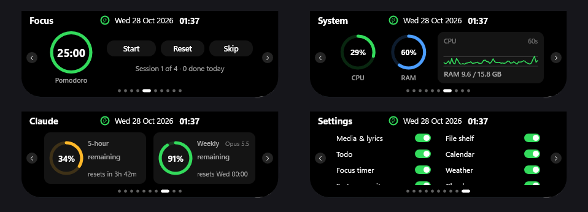

# Ada

A lightweight, native "Dynamic Island"-style notch for Windows 10 and 11 — written in Rust.

[Türkçe](#türkçe)



**Ada** places a small black pill at the top-center of your screen that smoothly expands into an interactive panel when you hover over it. Built directly on Win32, Direct2D, and DirectComposition via the `windows` crate, it ships as a single ~700 KB executable with no runtime dependencies and 0 FPS CPU usage when idle. *"Ada"* means *"island"* in Turkish, reflected in its Turkish red-and-white visual identity.

## Features

Every page can be turned on or off individually in **Settings**:

- **Media & lyrics** — Now playing from any app via Windows media controls, play/pause/next controls, synced lyrics from [LRCLIB](https://lrclib.net), plus album art and animated audio bars in the collapsed notch.
- **File shelf** — Drag files or links onto the notch to hold them temporarily, drag them back out later, or click to open.
- **Todo** — Quick checklist right at the top of your screen.
- **Calendar** — Local calendar for viewing and managing upcoming items.
- **Focus timer** — Pomodoro timer (25 / 5 / 15 min) with a live countdown in the collapsed notch.
- **Weather** — Current conditions and short-term forecast using IP-based location and MET Norway data.
- **System monitor** — Live CPU and RAM usage rings with a 60-second CPU sparkline.
- **Claude usage** — 5-hour and weekly rate-limit rings for Claude Code (reads a local JSON file; see [Claude usage](#claude-usage)).
- **Notifications** — Mirrors Windows notifications as brief animated "peeks".
- **Settings** — Enable or disable pages and adjust notch behavior at any time.

Plus:

- **Idle mascot** — After 15 seconds of inactivity, Ada writes *"Merhaba"* in handwriting, reveals two happy eyes, and waves a 3D hand.
- **Minimal-notch mode** — Shrinks the idle pill into an unobtrusive compact strip.
- **System tray menu** — Quick toggles for *Start with Windows*, the mascot, minimal mode, and *Exit*.

## Download & Install

Download `Ada-Setup-x.y.z.exe` from the [Releases](https://github.com/Yemresalcan/ada-notch/releases) page and run it (no admin rights needed; installs to `%LOCALAPPDATA%\Programs\Ada`). A portable `ada.exe` is attached too.

> **Note (Windows SmartScreen):** Because the executable is not code-signed, Windows SmartScreen may show a warning on first run. Click **More info → Run anyway** to launch Ada.

### Requirements

- Windows 10 (version 1903 or newer) or Windows 11
- 64-bit (x64)

## Usage

- **Expand / collapse:** Hover your cursor over the notch at the top-center of the screen to open the panel; move away to collapse it.
- **Switch pages:** Click the left/right arrows or the page dots along the bottom of the panel.
- **Tray menu:** Right-click the Ada icon in the system tray to toggle *Start with Windows*, the idle mascot, minimal mode, or to exit.
- **Toggle features:** Open the **Settings** page (always the last page) to turn individual pages on or off. Disabled pages are not started in the background.
- **Data location:** Settings, todos, and calendar entries are stored as plain text in `%APPDATA%\Ada` (caches and shelf files live in `%LOCALAPPDATA%\Ada`).

## Claude Usage

The **Claude usage** page displays your remaining 5-hour and weekly Claude Code rate limits as progress rings.

Ada reads the usage JSON from the first configured path among:

1. The `ADA_CLAUDE_USAGE_FILE` environment variable
2. The `claude_usage_file` key in `%APPDATA%\Ada\settings.txt`
3. `%APPDATA%\Ada\claude-usage.json` (default)

Expected JSON format:

```json
{"rate_limits":{"five_hour":{"used_percentage":13,"resets_at":1793130600},"seven_day":{"used_percentage":91,"resets_at":1793134800}},"model":"Opus","ts":1793114906104}
```

For example, a Claude Code status-line script can write this file directly from its `rate_limits` input on each update. If you don't use Claude Code, you can turn the page off in **Settings**.

## Build from Source

1. Install [Rust](https://rustup.rs/) via `rustup` (both the `msvc` and `gnu` toolchains work).
2. Run in development mode:
   ```powershell
   cargo run
   ```
3. Build an optimized release binary:
   ```powershell
   cargo build --release
   ```
4. Build the release executable with the embedded application icon (requires Python for `tools/set_icon.py`; writes `dist/ada.exe`):
   ```powershell
   powershell -ExecutionPolicy Bypass -File tools/build-release.ps1
   ```
5. Build the installer (requires [Inno Setup 6](https://jrsoftware.org/isinfo.php)):
   ```powershell
   iscc installer/ada.iss
   ```

### Project Layout

| Path | Description |
| --- | --- |
| `src/shell.rs` | Window management, spring animations, hit-testing, and tray menu |
| `src/gfx.rs` | Direct3D 11 / Direct2D / DirectComposition renderer and `DrawCtx` drawing API |
| `src/pages/*` | Individual feature pages (one file per page) |
| `src/mascot.rs` | Idle *"Merhaba"* handwriting animation, eyes, and 3D waving hand |
| `src/worker.rs` | Background worker threads, UI thread `Waker`, and peek queue |
| `src/store.rs` | Plain-text settings and data persistence |
| `src/theme.rs` | Layout geometry, spring constants, and color palette |
| `assets/` | Application icons and mascot artwork |
| `tools/` | Release packaging (`build-release.ps1`) and icon embedding (`set_icon.py`) |
| `installer/` | Inno Setup 6 installer script (`ada.iss`) |

## Contributing

Contributions, bug reports, and ideas are welcome! Please read [CONTRIBUTING.md](CONTRIBUTING.md) before opening a pull request.

## License & Credits

- **License:** Apache-2.0 — see [LICENSE](LICENSE).
- **Credits & third-party notices:** see [NOTICE](NOTICE).

---

## Türkçe

Windows 10 ve 11 için Rust ile yazılmış, hafif ve yerel "Dynamic Island" tarzı ekran çentiği (notch).

**Ada**, ekranın üst-orta kısmında duran ve fareyle üzerine gelindiğinde etkileşimli bir panele dönüşen küçük siyah bir kapsüldür. `windows` küfesi (crate) üzerinden doğrudan Win32, Direct2D ve DirectComposition ile geliştirilmiştir; çalışma zamanı bağımlılığı olmayan tek bir ~700 KB `.exe` dosyasıdır ve boşta 0 FPS ile neredeyse sıfır işlemci kullanır. Türkçedeki *"ada"* kelimesinden adını alır ve kırmızı-beyaz Türk kimliğini taşır.

### Özellikler

Her sayfa **Settings** (Ayarlar) sayfasından ayrı ayrı açılıp kapatılabilir:

- **Medya ve şarkı sözleri (Media & lyrics)** — Windows medya kontrolleri üzerinden çalan herhangi bir uygulamayı gösterir; oynat/duraklat/sonraki tuşları, [LRCLIB](https://lrclib.net) üzerinden senkronize şarkı sözleri ve kapalı çentikte albüm kapağı ile hareketli ses çubukları sunar.
- **Dosya rafı (File shelf)** — Dosya veya bağlantıları çentiğe sürükleyip bırakın, daha sonra dışarı sürükleyin ya da tıklayarak açın.
- **Yapılacaklar (Todo)** — Ekranın tepesinde hızlı görev listesi.
- **Takvim (Calendar)** — Yerel takvim görünümü ve etkinlik takibi.
- **Odaklanma sayacı (Focus timer)** — Kapalı çentikte geri sayım gösteren Pomodoro sayacı (25 / 5 / 15 dk).
- **Hava durumu (Weather)** — IP tabanlı konum ve MET Norway verileriyle anlık hava durumu ve saatlik tahmin.
- **Sistem izleyici (System monitor)** — Canlı CPU ve RAM kullanım halkaları ile 60 saniyelik CPU grafiği (sparkline).
- **Claude kullanımı (Claude usage)** — Claude Code için 5 saatlik ve haftalık kullanım limitlerini halkalar halinde gösterir (yerel bir JSON dosyasını okur; bkz. [Claude Kullanımı](#claude-kullanımı)).
- **Bildirimler (Notifications)** — Windows bildirimlerini kısa animasyonlu "peek" önizlemeleri olarak yansıtır.
- **Ayarlar (Settings)** — Sayfaları ve çentik davranışını istediğiniz zaman açıp kapatın.

Ek olarak:

- **Boşta maskotu** — 15 saniye hareketsizlikten sonra el yazısıyla *"Merhaba"* yazar, iki mutlu göz belirir ve 3B bir el sallar.
- **Minimal çentik modu** — Boştayken çentiği daha küçük ve sade bir kapsüle dönüştürür.
- **Sistem tepsisi menüsü** — *Windows ile başlat (Start with Windows)*, maskot, minimal mod ve *Çıkış (Exit)* seçeneklerine hızlı erişim sağlar.

### İndirme ve Kurulum

[Releases](https://github.com/Yemresalcan/ada-notch/releases) sayfasından `Ada-Setup-x.y.z.exe` dosyasını indirip çalıştırın (yönetici izni gerekmez; `%LOCALAPPDATA%\Programs\Ada` dizinine kurulur). Kurulumsuz kullanmak isteyenler için taşınabilir `ada.exe` dosyası da sürümlere eklenmiştir.

> **Not (Windows SmartScreen):** Uygulama kod imzalı olmadığı için ilk çalıştırmada Windows SmartScreen uyarısı görünebilir. Başlatmak için **Ek bilgi → Yine de çalıştır** (*More info → Run anyway*) seçeneğine tıklayın.

#### Gereksinimler

- Windows 10 (sürüm 1903 veya üzeri) ya da Windows 11
- 64-bit (x64)

### Kullanım

- **Açma / kapatma:** Paneli genişletmek için fareyi ekranın üst-ortasındaki çentiğin üzerine getirin; uzaklaştırdığınızda kapanır.
- **Sayfa değiştirme:** Paneldeki sol/sağ oklara veya alt kısımdaki sayfa noktalarına tıklayın.
- **Tepsi menüsü:** Sistem tepsisindeki Ada simgesine sağ tıklayarak başlangıçta çalıştırma, maskot ve minimal mod ayarlarını değiştirin veya uygulamadan çıkın.
- **Özellikleri açıp kapatma:** Her zaman en sonda yer alan **Settings** sayfasından istediğiniz sayfayı etkinleştirin veya devre dışı bırakın.
- **Veri dizini:** Ayarlar ve kullanıcı verileri `%APPDATA%\Ada` altında (önbellek ve dosya rafı öğeleri `%LOCALAPPDATA%\Ada` altında) saklanır.

### Claude Kullanımı

**Claude usage** sayfası, Claude Code'un 5 saatlik ve haftalık kalan kullanım haklarını halka göstergeler olarak sunar.

Ada, aşağıdaki yollardan tanımlı olan ilk JSON dosyasını okur:

1. `ADA_CLAUDE_USAGE_FILE` ortam değişkeni
2. `%APPDATA%\Ada\settings.txt` içindeki `claude_usage_file` anahtarı
3. `%APPDATA%\Ada\claude-usage.json` (varsayılan)

Beklenen JSON biçimi:

```json
{"rate_limits":{"five_hour":{"used_percentage":13,"resets_at":1793130600},"seven_day":{"used_percentage":91,"resets_at":1793134800}},"model":"Opus","ts":1793114906104}
```

Örneğin bir Claude Code durum çubuğu (status-line) betiği, kendisine gelen `rate_limits` girdisini doğrudan bu dosyaya yazabilir. Claude Code kullanmıyorsanız bu sayfayı **Settings** altından kapatabilirsiniz.

### Kaynaktan Derleme

1. `rustup` ile [Rust](https://rustup.rs/) kurun (`msvc` ve `gnu` araç zincirlerinin ikisiyle de derlenir).
2. Geliştirme modunda çalıştırın:
   ```powershell
   cargo run
   ```
3. Sürüm (release) derlemesi alın:
   ```powershell
   cargo build --release
   ```
4. Uygulama simgesi gömülü sürüm çıktısını üretin (`tools/set_icon.py` için Python gerekir; çıktıyı `dist/ada.exe` olarak yazar):
   ```powershell
   powershell -ExecutionPolicy Bypass -File tools/build-release.ps1
   ```
5. Kurulum paketini oluşturun ([Inno Setup 6](https://jrsoftware.org/isinfo.php) gerekir):
   ```powershell
   iscc installer/ada.iss
   ```

#### Proje Yapısı

| Yol | Açıklama |
| --- | --- |
| `src/shell.rs` | Pencere yönetimi, yay animasyonları, fare etkileşimi ve sistem tepsisi menüsü |
| `src/gfx.rs` | Direct3D 11 / Direct2D / DirectComposition çizim motoru ve `DrawCtx` API'si |
| `src/pages/*` | Özellik sayfaları (her sayfa için ayrı dosya) |
| `src/mascot.rs` | Boşta *"Merhaba"* el yazısı animasyonu, gözler ve 3B el sallama |
| `src/worker.rs` | Arka plan iş parçacıkları, arayüz `Waker` köprüsü ve "peek" kuyruğu |
| `src/store.rs` | Düz metin tabanlı ayar ve veri kalıcılığı |
| `src/theme.rs` | Geometri, yay sabitleri ve renk paleti |
| `assets/` | Uygulama simgeleri ve maskot görselleri |
| `tools/` | Sürüm derleme (`build-release.ps1`) ve simge gömme (`set_icon.py`) betikleri |
| `installer/` | Inno Setup 6 kurulum betiği (`ada.iss`) |

### Katkıda Bulunma

Katkılarınızı, hata bildirimlerinizi ve önerilerinizi bekliyoruz! Bir pull request açmadan önce lütfen [CONTRIBUTING.md](CONTRIBUTING.md) dosyasını inceleyin.

### Lisans ve Teşekkürler

- **Lisans:** Apache-2.0 — ayrıntılar için [LICENSE](LICENSE) dosyasına bakın.
- **Üçüncü taraf bildirimleri ve veri kaynakları:** [NOTICE](NOTICE) dosyasına bakın.
